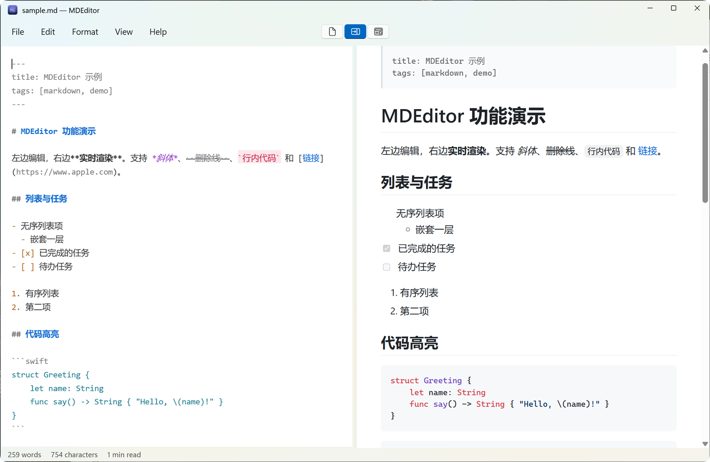
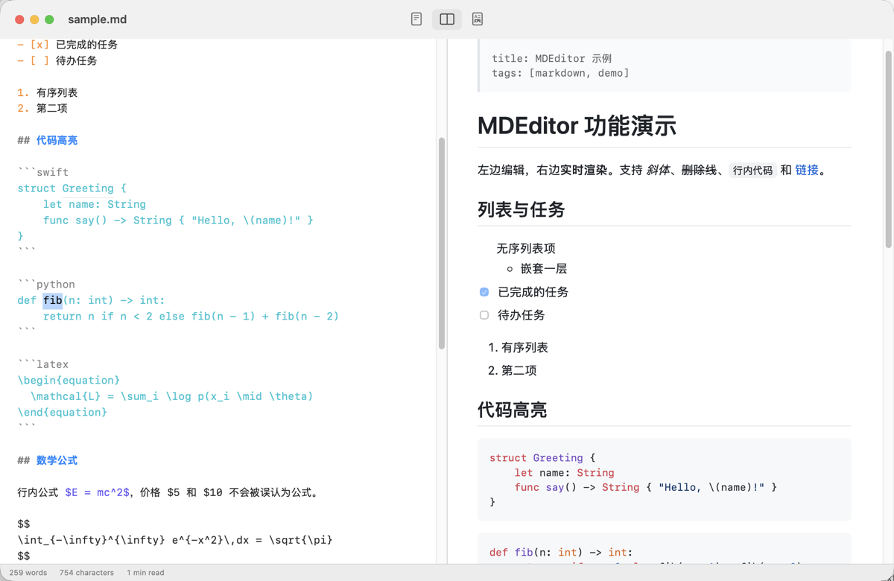
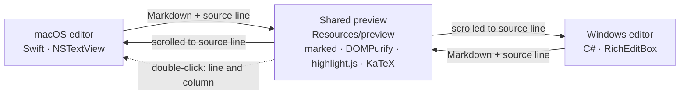

<div align="center">


# MDEditor

**Write Markdown on the left. See it rendered on the right.**

A small, offline Markdown editor that is native on both macOS and Windows.

[](../../releases/latest)

[](LICENSE)

English · [简体中文](README.zh-CN.md)

[Install](#install) · [Features](#features) · [Shortcuts](#shortcuts) · [Build](#build-from-source) · [How it works](#how-it-works)

<br>

<picture>
  <source media="(prefers-color-scheme: dark)" srcset="docs/images/windows-dark.png">
  
</picture>

<sub>Windows 11. The macOS app has the same layout and shares the same preview.</sub>

</div>

## Why MDEditor

- **Native on each platform.** SwiftUI and AppKit on macOS, WinUI 3 on Windows. Menus, dialogs, shortcuts and input methods behave the way the system expects.
- **Works offline.** Every rendering library ships inside the app. There are no accounts, no telemetry and no network calls of its own.
- **Stays aligned.** Scroll sync follows source lines rather than percentages, so long documents with images and tables stay in step.
- **Built with CJK in mind.** Nothing is re-coloured or re-rendered while an input method is composing, and word counts treat each CJK character as a word.

## Install

| | macOS 13 or later | Windows 10 (2004) or later |
| --- | --- | --- |
| **Architectures** | Universal (Apple silicon and Intel) | x64 and ARM64 |
| **Get it** | Homebrew or DMG | Installer or zip from [Releases](../../releases), or build from source |

### macOS

```bash
brew tap JYe16/tap
brew trust --tap JYe16/tap
brew install --cask mdeditor
```

Or download `MDEditor-<version>.dmg` from [Releases](../../releases) and drag the app into Applications.

<details>
<summary>If macOS refuses to open the app</summary>

MDEditor is ad-hoc signed but not notarized. The Homebrew cask clears the quarantine flag for you. After a DMG install, either go to **System Settings → Privacy & Security** and click **Open Anyway**, or run:

```bash
xattr -dr com.apple.quarantine /Applications/MDEditor.app
```

</details>

### Windows

Download `MDEditor-<version>-win-x64-setup.exe` (or `win-arm64`) from [Releases](../../releases), or the matching `.zip` for a portable copy; you can also [build the installer from source](#windows-1). Run the installer. It asks whether to install for you only (no administrator rights needed) or for all users, and lets you pick any folder. .NET and the Windows App SDK are bundled. The preview needs the WebView2 Runtime, which Windows 11 already has; on other systems the installer offers to download it. ARM64 packages are built but have not yet been tested on real hardware.

<details>
<summary>SmartScreen, default apps and security software</summary>

- The installer is not code-signed. If SmartScreen appears, choose **More info → Run anyway**.
- Setup adds MDEditor to "Open with". To make it the default, use **Settings → Apps → Default apps → MDEditor**; Windows reserves that choice for the user.
- Some security software blocks "Open with" registration. MDEditor still installs and works; to open a file with it, use **Open with → Choose another app** and browse to `MDEditor.exe`.

</details>

## Features

**Writing**
- Editor syntax colouring that follows light and dark mode
- Return continues lists, task lists and quotes; Return on an empty item ends them
- Tab and Shift+Tab indent lists and selected lines
- Find and replace, zoom, word count and reading time

**Preview**
- GitHub-flavoured Markdown: tables, task lists, strikethrough, autolinks and `> [!NOTE]` alerts
- YAML front matter
- Code highlighting in 43 languages, including Swift, Python, LaTeX, MATLAB and Julia
- KaTeX math, inline `$E=mc^2$` and display `$$ … $$`; prices such as `$5 and $10` stay plain text
- Incremental rendering: only the changed blocks rebuild, so there is no flicker and images don't reload
- Double-click a word in the preview to jump to its source: the editor selects that exact text and scrolls only if it has to, and the preview stays where it is

**Files and safety**
- Editor only, split and preview only views
- Print and PDF export
- Relative images resolve against the document's folder, and relative `.md` links open in MDEditor
- The preview is sanitized with DOMPurify, so a `<script>` in a document never runs
- Links to executables are never launched: MDEditor only shows them in Finder or Explorer
- English and Simplified Chinese interface, following the system language

<p align="center">
  
</p>

<sub>macOS. Double-clicking `fib` in the code block on the right selected it in the editor on the left, which scrolled to centre that line. The preview did not move.</sub>

Not supported yet: Mermaid diagrams, footnotes and emoji shortcodes.

## Shortcuts

| Action | macOS | Windows |
| --- | --- | --- |
| Editor / Split / Preview | `⌘1` `⌘2` `⌘3` | `Ctrl+Shift+1` `2` `3` |
| Bold / Italic | `⌘B` `⌘I` | `Ctrl+B` `Ctrl+I` |
| Strikethrough | `⇧⌘X` | `Ctrl+Shift+X` |
| Inline code | `⌥⌘C` | `Ctrl+E` |
| Link | `⌘K` | `Ctrl+K` |
| Heading 1 / 2 / 3 | `⌥⌘1` `2` `3` | `Ctrl+1` `2` `3` |
| Quote | `⌘'` | `Ctrl+Shift+Q` |
| Bulleted list | `⇧⌘8` | `Ctrl+Shift+L` |
| Task list | `⌥⌘T` | `Ctrl+Shift+T` |
| Code block | `⌥⌘K` | `Ctrl+Shift+K` |
| Find | `⌘F` | `Ctrl+F` |
| Replace | `⌥⌘F` | `Ctrl+H` |
| Print | `⌘P` | `Ctrl+P` |
| Zoom in / out / reset | `⌘+` `⌘-` `⌘0` | `Ctrl+=` `Ctrl+-` `Ctrl+0` |

## Build from source

The rendering libraries are checked in under `Resources/preview/vendor/`, so neither platform needs Node.

### macOS

Requires Xcode or the Command Line Tools.

```bash
./scripts/build.sh      # build/MDEditor.app
./scripts/make-dmg.sh   # build/MDEditor-<version>.dmg
./scripts/test.sh       # editing-command regression tests
```

### Windows

Requires the .NET 10 SDK and, for the installer, [Inno Setup 6](https://jrsoftware.org/isinfo.php). Run these from `windows/`:

```bash
./scripts/build.ps1
```

```bash
./scripts/publish.ps1
```

```bash
./scripts/make-installer.ps1
```

The installer is written to `windows/artifacts/`. More detail is in [`windows/README.md`](windows/README.md).

## How it works



The two editors are separate native programs. The preview is one HTML page, hosted in WKWebView on macOS and WebView2 on Windows, so rendering is identical on both.

| Path | Contents |
| --- | --- |
| `Sources/MDEditor/` | macOS app |
| `windows/src/MDEditor.App/` | Windows app |
| `windows/src/MDEditor.Core/` | Windows editing logic, free of UI code and testable on any OS |
| `Resources/preview/` | Shared preview page and bundled libraries |
| `examples/sample.md` | A document that exercises every feature |

## Contributing

Issues and pull requests are welcome. Before sending a change to editing behaviour, please run the tests for the platform you touched: `./scripts/test.sh` on macOS, `dotnet test windows/tests/MDEditor.Core.Tests` for the Windows logic. The release process is in [docs/RELEASING.md](docs/RELEASING.md).

## License

[MIT](LICENSE) © 2026 JYe16. Bundled libraries keep their own licenses: see [THIRD_PARTY_NOTICES.md](THIRD_PARTY_NOTICES.md) and [the Windows notices](windows/THIRD_PARTY_NOTICES.md).
