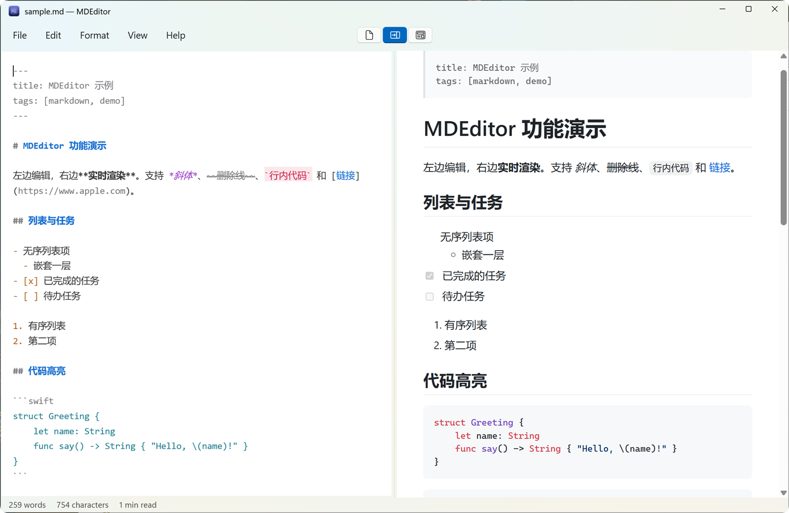
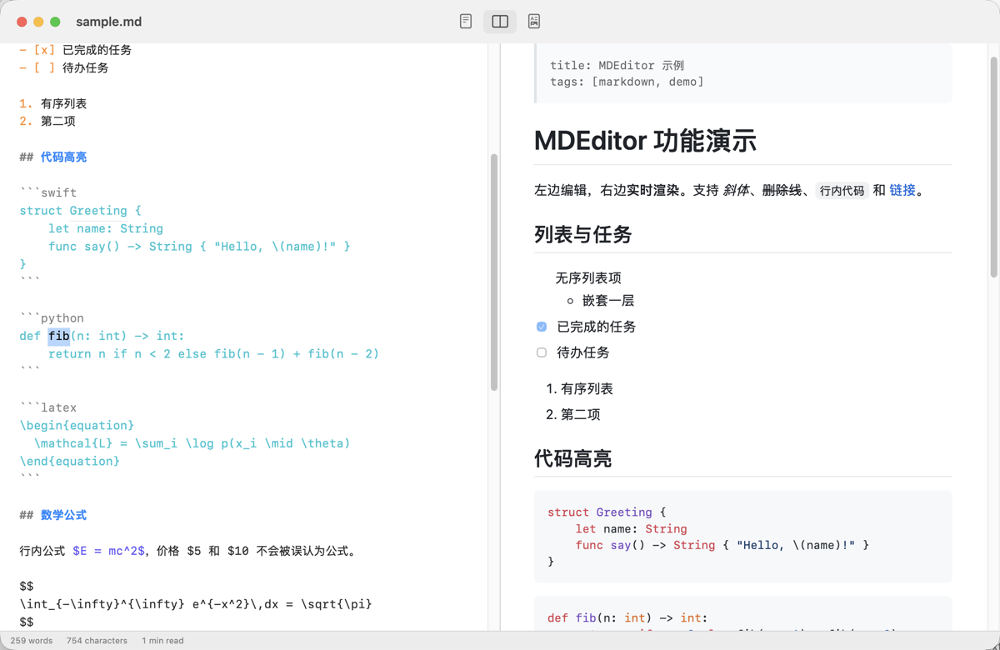
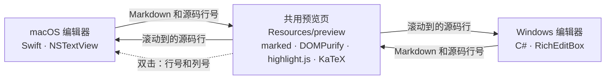

<div align="center">


# MDEditor

**左边写 Markdown，右边看渲染结果。**

一款小巧、离线可用的 Markdown 编辑器，在 macOS 和 Windows 上都是原生应用。

[](../../releases/latest)

[](LICENSE)

[English](README.md) · 简体中文

[安装](#安装) · [功能](#功能) · [快捷键](#快捷键) · [构建](#从源码构建) · [实现方式](#实现方式)

<br>

<picture>
  <source media="(prefers-color-scheme: dark)" srcset="docs/images/windows-dark.png">
  
</picture>

<sub>Windows 11 界面。macOS 版布局相同，预览也是同一套。</sub>

</div>

## 为什么用 MDEditor

- **两个平台都是原生应用。** macOS 用 SwiftUI 和 AppKit，Windows 用 WinUI 3。菜单、对话框、快捷键和输入法都符合各自系统的习惯。
- **完全离线。** 渲染库全部打包在应用内。不需要账号，没有遥测，应用自身不联网。
- **滚动对得齐。** 滚动同步按源码行定位，而不是按百分比，长文档里有图片和表格也不会错位。
- **认真对待中文。** 输入法组字时不会触发着色和渲染；字数统计把每个汉字算作一个字。

## 安装

| | macOS 13 及以上 | Windows 10（2004）及以上 |
| --- | --- | --- |
| **架构** | Universal（Apple 芯片和 Intel） | x64 和 ARM64 |
| **获取方式** | Homebrew 或 DMG | 从源码构建，或等安装包发布到 [Releases](../../releases) |

### macOS

```bash
brew tap JYe16/tap
brew trust --tap JYe16/tap
brew install --cask mdeditor
```

也可以到 [Releases](../../releases) 下载 `MDEditor-<版本>.dmg`，把应用拖进“应用程序”。

<details>
<summary>macOS 拒绝打开应用时</summary>

MDEditor 只做了 ad-hoc 签名，没有经过 Apple 公证。通过 Homebrew 安装时，cask 会自动清除隔离标记。用 DMG 安装的话，可以到**系统设置 → 隐私与安全性**点击**仍要打开**，或者运行：

```bash
xattr -dr com.apple.quarantine /Applications/MDEditor.app
```

</details>

### Windows

> [!NOTE]
> Windows 安装包还没有放到 Releases，当前版本只有 macOS 的 DMG。在下一个带标签的版本发布之前，请[从源码构建安装程序](#windows-1)。

运行安装程序后，可以选择仅为自己安装（不需要管理员权限）或为所有用户安装，安装位置可以任选。.NET 和 Windows App SDK 已经打包在内。预览依赖 WebView2 运行库，Windows 11 自带；其他系统上安装程序会提示下载。ARM64 安装包已能构建，但还没有在真机上测试过。

<details>
<summary>SmartScreen、默认应用和安全软件</summary>

- 安装程序没有代码签名。如果出现 SmartScreen 提示，选择**更多信息 → 仍要运行**。
- 安装程序会把 MDEditor 加入“打开方式”。要设为默认程序，请到**设置 → 应用 → 默认应用 → MDEditor**，这个选择 Windows 只留给用户自己。
- 部分安全软件会阻止注册“打开方式”，这不影响安装和使用。需要打开文件时，选择**打开方式 → 选择其他应用**，然后找到 `MDEditor.exe`。

</details>

## 功能

**写作**
- 编辑器语法着色，跟随浅色和深色模式
- 回车自动续写列表、任务和引用，在空项上回车则结束
- Tab 和 Shift+Tab 缩进列表及选中的行
- 查找替换、缩放、字数和阅读时间统计

**预览**
- GitHub 风格 Markdown：表格、任务列表、删除线、自动链接和 `> [!NOTE]` 提示块
- YAML front matter
- 代码高亮，支持 43 种语言，包括 Swift、Python、LaTeX、MATLAB 和 Julia
- KaTeX 数学公式，行内 `$E=mc^2$`，块级 `$$ … $$`；`$5 和 $10` 这样的价格不会被当成公式
- 增量渲染：只重建改动的块，不闪烁，图片也不会重新加载
- 在预览里双击某个词，编辑器会跳到它的 Markdown 源码并选中：只在必要时才滚动，预览保持不动。目前仅 macOS 版支持，Windows 版是下一步

**文件与安全**
- 仅编辑、分栏、仅预览三种视图
- 打印和导出 PDF
- 相对路径的图片按文档所在目录解析，相对路径的 `.md` 链接在 MDEditor 中打开
- 预览经 DOMPurify 过滤，文档里的 `<script>` 不会执行
- 指向可执行文件的链接绝不会被运行，只会在访达或资源管理器中显示
- 英文和简体中文界面，跟随系统语言

<p align="center">
  
</p>

<sub>macOS 版。在右侧代码块里双击 `fib`，左侧编辑器选中了对应的源码，并滚动到让这一行居中。预览没有移动。</sub>

暂不支持：Mermaid 图表、脚注和 emoji 短代码。

## 快捷键

| 操作 | macOS | Windows |
| --- | --- | --- |
| 仅编辑 / 分栏 / 仅预览 | `⌘1` `⌘2` `⌘3` | `Ctrl+Shift+1` `2` `3` |
| 粗体 / 斜体 | `⌘B` `⌘I` | `Ctrl+B` `Ctrl+I` |
| 删除线 | `⇧⌘X` | `Ctrl+Shift+X` |
| 行内代码 | `⌥⌘C` | `Ctrl+E` |
| 链接 | `⌘K` | `Ctrl+K` |
| 一 / 二 / 三级标题 | `⌥⌘1` `2` `3` | `Ctrl+1` `2` `3` |
| 引用 | `⌘'` | `Ctrl+Shift+Q` |
| 无序列表 | `⇧⌘8` | `Ctrl+Shift+L` |
| 任务列表 | `⌥⌘T` | `Ctrl+Shift+T` |
| 代码块 | `⌥⌘K` | `Ctrl+Shift+K` |
| 查找 | `⌘F` | `Ctrl+F` |
| 替换 | `⌥⌘F` | `Ctrl+H` |
| 打印 | `⌘P` | `Ctrl+P` |
| 放大 / 缩小 / 实际大小 | `⌘+` `⌘-` `⌘0` | `Ctrl+=` `Ctrl+-` `Ctrl+0` |

## 从源码构建

渲染库已放在 `Resources/preview/vendor/`，两个平台都不需要 Node。

### macOS

需要 Xcode 或 Command Line Tools。

```bash
./scripts/build.sh      # 生成 build/MDEditor.app
./scripts/make-dmg.sh   # 生成 build/MDEditor-<版本>.dmg
./scripts/test.sh       # 编辑命令回归测试
```

### Windows

需要 .NET 10 SDK；打包安装程序还需要 [Inno Setup 6](https://jrsoftware.org/isinfo.php)。在 `windows/` 目录下运行：

```bash
./scripts/build.ps1
```

```bash
./scripts/publish.ps1
```

```bash
./scripts/make-installer.ps1
```

安装程序会生成在 `windows/artifacts/`。更多说明见 [`windows/README.md`](windows/README.md)。

## 实现方式



两个编辑器是各自独立的原生程序。预览是同一个 HTML 页面，在 macOS 上由 WKWebView 承载，在 Windows 上由 WebView2 承载，所以两边的渲染结果一致。

| 路径 | 内容 |
| --- | --- |
| `Sources/MDEditor/` | macOS 应用 |
| `windows/src/MDEditor.App/` | Windows 应用 |
| `windows/src/MDEditor.Core/` | Windows 编辑逻辑，不含 UI 代码，可在任何系统上测试 |
| `Resources/preview/` | 共用预览页和内置的渲染库 |
| `examples/sample.md` | 覆盖全部功能的示例文档 |

## 参与贡献

欢迎提 issue 和 PR。修改编辑行为前，请运行对应平台的测试：macOS 用 `./scripts/test.sh`，Windows 逻辑用 `dotnet test windows/tests/MDEditor.Core.Tests`。发布流程见 [docs/RELEASING.md](docs/RELEASING.md)。

## 许可证

[MIT](LICENSE) © 2026 JYe16。内置的第三方库保留各自的许可证，见 [THIRD_PARTY_NOTICES.md](THIRD_PARTY_NOTICES.md) 和 [Windows 版声明](windows/THIRD_PARTY_NOTICES.md)。
